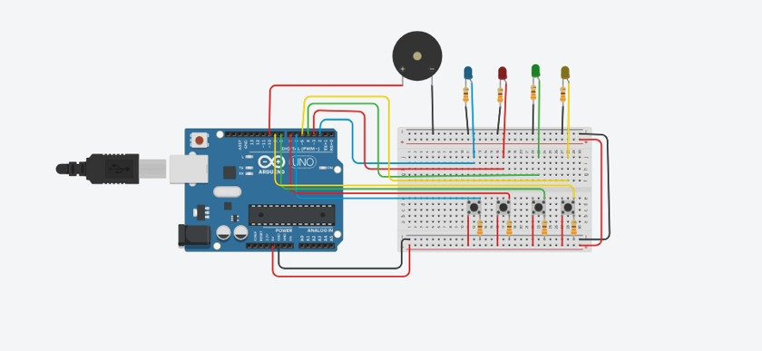
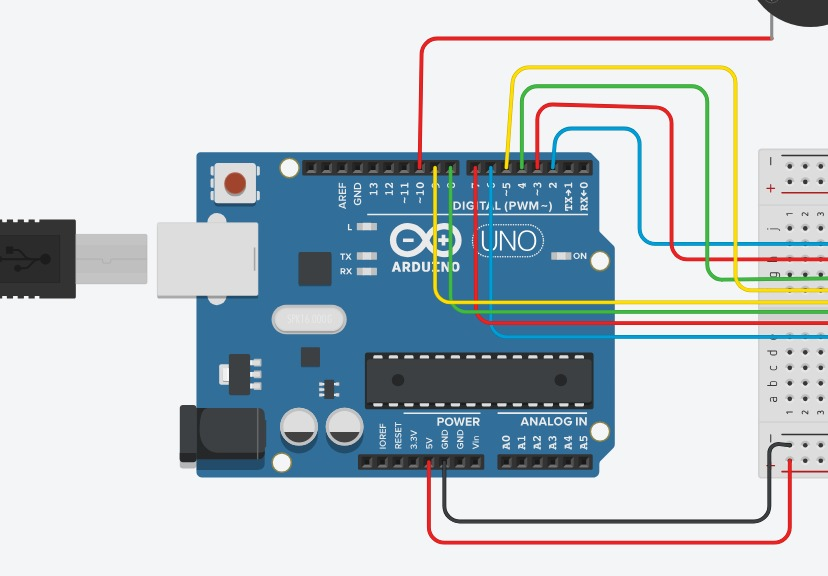
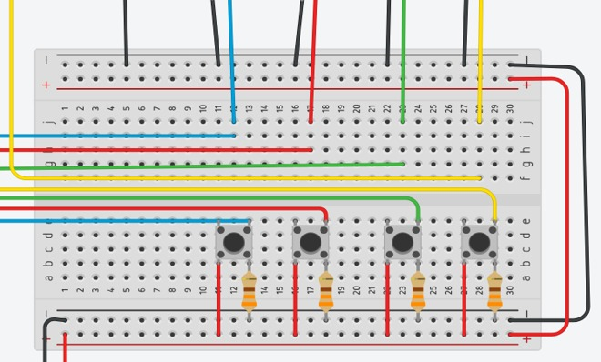

# Montaje electrónico compartido

Este montaje es el **mismo para [Simón Dice](../Simon-Dice/README.md) y [Kill the Bit](../Kill-the-Bit/README.md)**. Para cambiar de juego solo se carga otro programa en el Arduino.

## Componentes

Según la [lista de materiales](../Documentacion/Materiales/Lista-de-materiales.csv):

| Referencia | Cantidad | Componente |
|---|---|---|
| U1 | 1 | Arduino Uno R3 |
| 1 | 1 | Placa de pruebas pequeña |
| D1 | 1 | LED azul |
| D2 | 1 | LED rojo |
| D3 | 1 | LED verde |
| D4 | 1 | LED amarillo |
| R1, R2, R3, R4, R5, R6, R7, R8 | 8 | Resistencia de 470 Ω |
| S1, S2, S3, S4 | 4 | Pulsador |
| PIEZO1 | 1 | Piezo |

## Conexiones con el Arduino

Los pines son los que usan los dos programas.

| Color | LED | Pulsador |
|---|---|---|
| Azul | D2 | D6 |
| Rojo | D3 | D7 |
| Verde | D4 | D8 |
| Amarillo | D5 | D9 |

| Elemento | Conexión |
|---|---|
| Piezo | D10 y GND |
| Alimentación de los pulsadores | 5 V |

- **LED:** cada LED va en serie con una resistencia entre su pin digital y GND.
- **Pulsadores:** un lado del pulsador va a 5 V y el otro al pin digital, con una resistencia pull-down a GND. Por eso el pin lee `HIGH` al pulsar y los programas usan `INPUT` (sin `INPUT_PULLUP`).

## Esquemático

[Ver esquemático (PDF)](../Documentacion/Esquematico/Esquematico-electronico.pdf)

## Imágenes de referencia

Capturas de la simulación en Tinkercad (no son fotografías de un montaje físico):

## Nota sobre el valor de las resistencias

La lista de materiales y la captura de componentes indican resistencias de **470 Ω**, igual que el comentario del código de Kill the Bit. El esquemático en PDF muestra las ocho resistencias rotuladas como **330 Ω**. Verifica cuál valor corresponde al montaje antes de armarlo.
