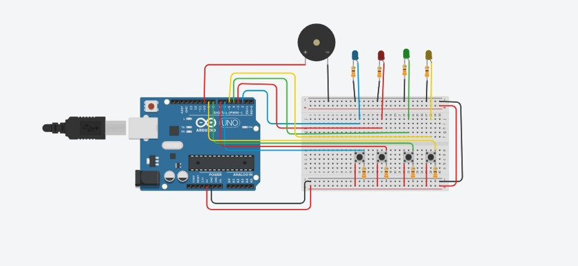

# Configuración de Dispositivos Electrónicos

Proyectos desarrollados en la asignatura **Configuración de Dispositivos Electrónicos** de **Ingeniería de Sistemas**, **Universidad de Córdoba (Colombia)**.

El repositorio reúne dos juegos electrónicos con Arduino UNO, **Simón Dice** y **Kill the Bit**, junto con su documentación: lista de materiales, esquemático, imágenes de la simulación en Tinkercad y código fuente.

**Autor:** Juan Paulo Lugo Rico

## Los dos proyectos

| Proyecto | Descripción | Código | Documentación |
|---|---|---|---|
| **Simón Dice** | Se muestra una secuencia de 4 colores con los LED y el jugador debe repetirla con los pulsadores. | [`Simon-Dice.ino`](Simon-Dice/Simon-Dice.ino) | [Simon-Dice/README.md](Simon-Dice/README.md) |
| **Kill the Bit** | Un LED recorre los colores y el jugador debe pulsar el botón del color encendido para apagarlo. Se gana al apagar los 4 LED. | [`Kill-the-Bit.ino`](Kill-the-Bit/Kill-the-Bit.ino) | [Kill-the-Bit/README.md](Kill-the-Bit/README.md) |

## Un solo montaje, dos programas

Ambos juegos usan **exactamente el mismo montaje electrónico**. Lo único que cambia es el programa que se carga en la placa Arduino:

- Para jugar **Simón Dice**, se carga `Simon-Dice/Simon-Dice.ino`.
- Para jugar **Kill the Bit**, se carga `Kill-the-Bit/Kill-the-Bit.ino`.

No hace falta modificar ninguna conexión para cambiar de juego. Los materiales, las conexiones y el esquemático se documentan una sola vez en [Montaje-Electronico](Montaje-Electronico/README.md).

## Funcionamiento general del montaje

El circuito tiene tres partes:

- **4 LED** (azul, rojo, verde y amarillo), cada uno con su resistencia, conectados a los pines digitales D2 a D5.
- **4 pulsadores** (uno por color), conectados a los pines digitales D6 a D9, cada uno con una resistencia pull-down a GND.
- **1 piezo (buzzer)** conectado al pin D10 y a GND, que emite los sonidos del juego.

Todo se monta sobre una placa de pruebas pequeña conectada a un Arduino UNO R3. El detalle de pines y conexiones está en [Montaje-Electronico/README.md](Montaje-Electronico/README.md).



## Materiales

Resumen de la [lista de materiales](Documentacion/Materiales/Lista-de-materiales.csv):

| Referencia | Cantidad | Componente |
|---|---|---|
| U1 | 1 | Arduino Uno R3 |
| 1 | 1 | Placa de pruebas pequeña |
| D1 | 1 | LED azul |
| D2 | 1 | LED rojo |
| D3 | 1 | LED verde |
| D4 | 1 | LED amarillo |
| R1 a R8 | 8 | Resistencia de 470 Ω |
| S1 a S4 | 4 | Pulsador |
| PIEZO1 | 1 | Piezo |

> Ver la nota sobre el valor de las resistencias en [Montaje-Electronico](Montaje-Electronico/README.md#nota-sobre-el-valor-de-las-resistencias).

## Esquemático e imágenes

- [Esquemático electrónico (PDF)](Documentacion/Esquematico/Esquematico-electronico.pdf)
- Imágenes de la simulación en Tinkercad:
  - [Vista general](Documentacion/Imagenes/Montaje-Tinkercad/Tinkercad-Vista-general.png)
  - [Conexiones del Arduino](Documentacion/Imagenes/Montaje-Tinkercad/Tinkercad-Arduino.png)
  - [Conexiones en la protoboard](Documentacion/Imagenes/Montaje-Tinkercad/Tinkercad-Protoboard.png)
- [Captura de la lista de componentes de Tinkercad](Documentacion/Imagenes/Referencias/Lista-de-componentes.png)

Las imágenes son **capturas de la simulación en Tinkercad**, no fotografías de un montaje físico.

## Estructura del repositorio

```text
Configuracion-Dispositivos-Electronicos/
├── README.md
├── Documentacion/
│   ├── Materiales/
│   │   └── Lista-de-materiales.csv
│   ├── Esquematico/
│   │   └── Esquematico-electronico.pdf
│   └── Imagenes/
│       ├── Montaje-Tinkercad/
│       └── Referencias/
├── Montaje-Electronico/
│   └── README.md
├── Simon-Dice/
│   ├── Simon-Dice.ino
│   └── README.md
└── Kill-the-Bit/
    ├── Kill-the-Bit.ino
    └── README.md
```

## Cómo cargar cada juego

1. Descarga o clona el repositorio.
2. Arma el circuito siguiendo [Montaje-Electronico](Montaje-Electronico/README.md).
3. Abre en el **Arduino IDE** el archivo `.ino` del juego que quieras. Cada `.ino` está en una carpeta con su mismo nombre, como exige el IDE.
4. Selecciona la placa **Arduino Uno** y el puerto correspondiente.
5. Pulsa **Subir**.

Ninguno de los dos programas usa librerías externas.

## Tecnologías y herramientas

- Arduino UNO R3
- Lenguaje de programación de Arduino (C++)
- Arduino IDE
- Tinkercad (simulación y esquemático)
